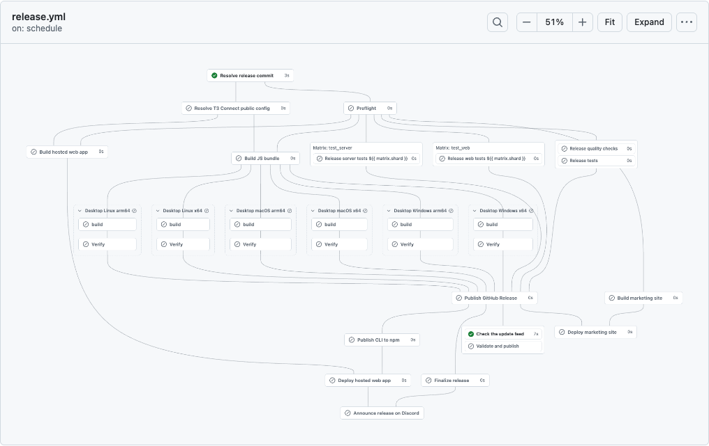

# BGAV

Better GitHub Actions Visualizer.



GitHub draws workflow runs as a left-to-right graph. That works for a handful of jobs. It falls apart on a real release pipeline with matrix builds across platforms, reusable workflows, and jobs that wait on five others. You scroll sideways, open matrices one by one, and trace lines with your finger to find out why the release job never started.

BGAV is a Chrome extension that redraws that graph top-down, so the run reads like the pipeline you wrote. Stages flow down the page. A reusable workflow called once per platform becomes a row of small dashed boxes, each showing its own build and verify steps. Matrix jobs are listed inside their card with status and duration, without a click. When something fails, a red chip at the top tells you, and clicking it takes you there.

It runs only on workflow run pages (`github.com/<owner>/<repo>/actions/runs/<id>`) and leaves the rest of GitHub alone.

## What you get

- A top-down layout with curved edges, computed by [ELK](https://eclipse.dev/elk/).
- Matrix jobs fetched and listed in place. Groups larger than 12 jobs start collapsed and show a status bar plus the jobs that need attention.
- Jobs from the same reusable workflow call grouped in a dashed box you can collapse.
- Wide fan-outs of parallel jobs packed into a grid, so a 30-job test stage doesn't stretch the graph across three screens.
- Live status and running durations. The graph updates as GitHub streams changes, and keeps your zoom and position.
- Hover a job to highlight everything upstream and downstream of it. Turn on "Critical path" to see the chain of jobs that decided how long the run took.
- Search by job name, and filter by status with the chips in the header.
- Zoom, pan, pinch, fit to view, and a full-screen mode. An overview map appears for graphs too big to fit.
- Light and dark themes that follow GitHub's.
- One click in the menu switches back to GitHub's own graph.

## Shortcuts

Click the graph first so it has focus.

| Key        | Action                       |
| ---------- | ---------------------------- |
| `/`        | Search jobs                  |
| `n` / `N`  | Next / previous match        |
| `0`        | Fit to view                  |
| `1`        | Zoom to 100%                 |
| `+` / `-`  | Zoom in / out                |
| Arrow keys | Pan                          |
| `e` / `c`  | Expand / collapse all groups |
| `f`        | Full screen                  |
| `Esc`      | Leave search or full screen  |

Hold Ctrl or Cmd and scroll to zoom. In full screen, scrolling pans.

## Install

BGAV is not in the Chrome Web Store yet. Build it from source:

```sh
mise install
pnpm install
pnpm build
```

Then open `chrome://extensions`, turn on Developer mode, click "Load unpacked", and pick the `dist` folder. It works in any Chromium browser, version 111 or later.

The extension asks for one permission, `storage`, to remember your settings. It reads the run page you are on and fetches matrix job lists from github.com with your existing session. Nothing is sent anywhere else.

## Development

[mise](https://mise.jdx.dev) installs the pinned Node.js and pnpm from `.mise.toml`.

- `pnpm dev` rebuilds on save. Load `dist` as above and reload the page.
- `pnpm check` typechecks, lints with oxlint, checks formatting with oxfmt, and runs the tests. CI runs the same command.
- `pnpm preview <run-url>...` opens run pages in Playwright's Chromium with the built extension and saves screenshots to `preview/`. Run `pnpm exec playwright install chromium` once first.
- `pnpm zip` builds and packs `dist` into a zip for the Web Store.

The code is split by job. `src/github` reads GitHub's graph markup, `src/model` turns it into a view with groups and collapse state, `src/layout` places it with ELK, and `src/view` draws it in a shadow root.

GitHub changes its markup now and then. If BGAV can't read a page, it shows GitHub's graph and says so, instead of drawing something wrong. The parser tests run against saved copies of real run pages in `test/fixtures`.

## License

[MIT](LICENSE). The bundled ELK layout engine (elkjs) is licensed under [EPL-2.0](https://www.eclipse.org/legal/epl-2.0/). Icons come from GitHub's [Octicons](https://github.com/primer/octicons), licensed MIT.
